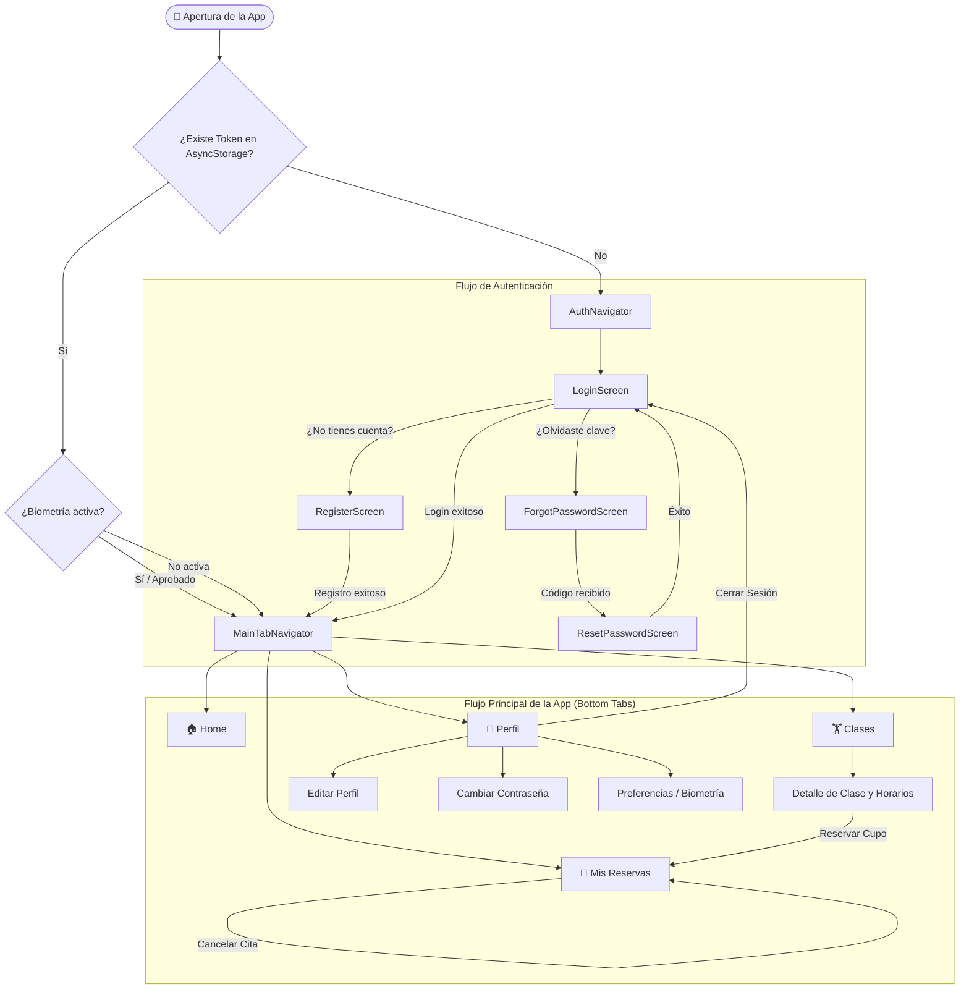

# 📱 SmartGym Mobile - Documentación de la Aplicación Móvil

Documentación técnica integral de la aplicación móvil de **SmartGym**, desarrollada en **React Native** con el ecosistema **Expo**. Cubre la estructura de pantallas, navegación, gestión del estado de autenticación, integración con la API REST y configuración de red local.

---

## 📑 Tabla de Contenidos
1. [Visión General de la App](#-visión-general-de-la-app)
2. [Stack Tecnológico](#-stack-tecnológico)
3. [Estructura del Proyecto Mobile](#-estructura-del-proyecto-mobile)
4. [Flujos y Pantallas de Usuario](#-flujos-y-pantallas-de-usuario)
5. [Arquitectura de Navegación](#-arquitectura-de-navegación)
6. [Gestión de Estado y Sesión (`AuthContext`)](#-gestión-de-estado-y-sesión-authcontext)
7. [Integración con el Backend (API Client)](#-integración-con-el-backend-api-client)
8. [Diseño y Sistema Visual (Theming)](#-diseño-y-sistema-visual-theming)
9. [Guía de Ejecución y Pruebas en Dispositivos](#-guía-de-ejecución-y-pruebas-en-dispositivos)

---

## 🌟 Visión General de la App

La aplicación móvil de SmartGym permite a los socios del gimnasio:
* **Autenticarse de forma segura:** Inicio de sesión clásico por correo/contraseña o mediante **biometría (Face ID / Huella dactilar)**.
* **Recuperar su cuenta:** Flujo de solicitud y restablecimiento de contraseña mediante códigos de seguridad.
* **Consultar clases y aforo en vivo:** Visualizar disciplinas (Spinning, CrossFit, Yoga, etc.) y verificar los cupos disponibles en tiempo real.
* **Agendar citas con un solo toque:** Reservar sesiones evitando automáticamente cruces de horarios y sobrecupos.
* **Gestionar sus reservas:** Ver reservas activas, historial y realizar cancelaciones con devolución inmediata de cupo.
* **Gestionar su perfil:** Ver estado y vigencia de su membresía, actualizar datos de contacto, contacto de emergencia y cambiar su foto de perfil.

---

## 🛠️ Stack Tecnológico

| Componente | Tecnología | Versión | Propósito |
| :--- | :--- | :--- | :--- |
| **Framework Base** | React Native | `0.86.3` | Framework multiplataforma nativo (Android / iOS) |
| **Ecosistema & Herramientas** | Expo SDK | `~57.0.28` | Plataforma de desarrollo, herramientas y compilación |
| **Navegación** | `@react-navigation/native` | `^7.5.0` | Enrutador principal de pantallas y contenedores |
| **Navegación en Pila** | `@react-navigation/native-stack` | `^7.20.0` | Transiciones fluidas entre pantallas de Auth y Detalles |
| **Navegación por Pestañas** | `@react-navigation/bottom-tabs` | `^7.20.0` | Barra de pestañas inferior (Home, Clases, Reservas, Perfil) |
| **Cliente HTTP** | `axios` | `^1.20.0` | Peticiones HTTP con interceptores automáticos de JWT |
| **Almacenamiento Local** | `@react-native-async-storage/async-storage` | `2.2.0` | Persistencia de token JWT, datos de usuario y configuración de IP |
| **Seguridad Biométrica** | `expo-local-authentication` | `~57.0.3` | Acceso con huella dactilar y reconocimiento facial |
| **Selector Multimedia** | `expo-image-picker` | `~57.0.20` | Captura desde cámara o galería para la foto de avatar |
| **Iconografía** | `@expo/vector-icons` (Ionicons) | `^15.0.2` | Iconos vectoriales de alto rendimiento |

---

## 📂 Estructura del Proyecto Mobile

```text
mobile/
├── App.js                     # Punto de entrada de la aplicación y montaje de proveedores
├── app.json                   # Configuración del proyecto Expo (nombre, ícono, splash)
├── package.json               # Dependencias de React Native y librerías
├── AGENTS.md                  # Pautas de desarrollo para agentes IA
└── src/
    ├── components/            # Componentes visuales reutilizables
    │   ├── Card.js            # Tarjeta con elevación y bordes redondeados
    │   ├── CustomButton.js    # Botón dinámico con variantes (primary, outline, danger)
    │   └── CustomInput.js     # Campo de texto estilizado con toggle de visibilidad (ojito)
    ├── config/
    │   └── api.js             # Cliente Axios con interceptor dinámico de JWT e IP
    ├── context/
    │   ├── AuthContext.js         # Proveedor de estado global de sesión y biometría
    │   └── NotificationContext.js # Proveedor de notificaciones y enlace en tiempo real
    ├── services/
    │   └── notificationService.js # Socket.IO cliente + configuración nativa de Expo Notifications
    ├── navigation/
    │   ├── AppNavigator.js     # Selector condicional (¿Está autenticado?)
    │   ├── AuthNavigator.js    # Stack de pantallas para usuarios no logueados
    │   └── MainTabNavigator.js # Navegación por pestañas para usuarios logueados
    ├── screens/
    │   ├── auth/              # Pantallas de autenticación
    │   │   ├── LoginScreen.js          # Inicio de sesión + configuración de IP
    │   │   ├── RegisterScreen.js       # Registro de nuevos socios
    │   │   ├── ForgotPasswordScreen.js # Solicitud de código de recuperación
    │   │   └── ResetPasswordScreen.js  # Ingreso de código y nueva contraseña
    │   ├── home/
    │   │   └── HomeScreen.js           # Dashboard principal, estado de membresía y resumen
    │   ├── clases/
    │   │   ├── ClasesScreen.js         # Catálogo de clases con filtro y aforo
    │   │   └── DetalleClaseScreen.js   # Horarios de la clase y reserva directa
    │   ├── reservas/
    │   │   └── MisReservasScreen.js    # Listado de citas, estados y cancelación
    │   └── perfil/
    │       ├── ProfileScreen.js        # Vista de perfil, membresía y avatar
    │       ├── EditProfileScreen.js    # Edición de teléfono y contactos
    │       ├── UpdatePasswordScreen.js # Cambio seguro de clave
    │       └── PreferencesScreen.js    # Activar/desactivar biometría y avisos
    └── theme/
        └── colors.js          # Paleta de colores oficial estilo oscuro deportivo
```

---

## 📱 Flujos y Pantallas de Usuario



### Detalle de Módulos de Pantallas:

1. **Autenticación (`screens/auth/`):**
   * `LoginScreen`: Validación de campos, inicio de sesión contra el backend, botón de acceso biométrico rápido y modal emergente para configurar la IP del servidor si cambia de red Wi-Fi.
   * `RegisterScreen`: Formulario con validación de nombre, correo, contraseña, teléfono y contactos de emergencia.
   * `ForgotPasswordScreen` & `ResetPasswordScreen`: Solicitud del código demo (`123456`) y cambio de clave con confirmación.

2. **Inicio (`screens/home/`):**
   * Saludo dinámico según la hora del día.
   * Tarjeta de membresía con alerta de vencimiento (verde si activa, roja/amarilla si por vencer).
   * Tarjeta con la **próxima clase reservada** (fecha, hora, disciplina y profesor).
   * Accesos directos para agendar clase o ver el catálogo.

3. **Clases y Horarios (`screens/clases/`):**
   * Catálogo de disciplinas con descripción, duración e indicadores de intensidad.
   * Pantalla de detalle con selector de horarios disponibles y **cálculo de aforo en vivo**:
     * 🟢 Más del 50% de cupos disponibles.
     * 🟡 Menos del 50% de cupos (últimos cupos).
     * 🔴 Agotado / Aforo completo.

4. **Mis Reservas (`screens/reservas/`):**
   * Lista clasificada en reservas **Activas/Confirmadas** y reservas **Pasadas/Canceladas**.
   * Botón para cancelar reserva con confirmación de alerta nativa y actualización automática de la lista.

5. **Perfil de Usuario (`screens/perfil/`):**
   * Foto de perfil circular con botón de cámara para actualizar avatar usando `expo-image-picker`.
   * Detalle de la membresía contratada y fecha límite.
   * Configuración de preferencias (activación de huella/FaceID con persistencia en `AsyncStorage`).

---

## 🧭 Arquitectura de Navegación

Ubicación: `src/navigation/`

* **`AppNavigator.js`:** Es el enrutador raíz. Escucha el estado `userToken` del `AuthContext`:
  * Si `userToken` es `null`, renderiza `AuthNavigator`.
  * Si `userToken` existe, renderiza `MainTabNavigator`.
  * Mientras valida el token inicial, muestra un `ActivityIndicator` nativo en pantalla completa.
* **`AuthNavigator.js`:** Pila `createNativeStackNavigator` con animación nativa:
  * Rutas: `Login`, `Register`, `ForgotPassword`, `ResetPassword`.
* **`MainTabNavigator.js`:** Pestañas inferiores `createBottomTabNavigator`:
  * Pestaña 1: `Home` (`HomeScreen`)
  * Pestaña 2: `ClasesStack` (`ClasesScreen` + `DetalleClaseScreen`)
  * Pestaña 3: `Reservas` (`MisReservasScreen`)
  * Pestaña 4: `PerfilStack` (`ProfileScreen` + `EditProfileScreen` + `UpdatePasswordScreen` + `PreferencesScreen`)

---

## 🔐 Gestión de Estado y Sesión (`AuthContext`)

Ubicación: `src/context/AuthContext.js`

El `AuthContext` gestiona de forma centralizada la sesión de usuario en toda la aplicación:

### Funciones Expuestas:
* `login(email, password)`: Envía credenciales a `/api/auth/login`, guarda el JWT y perfil en `AsyncStorage`, y actualiza el estado global.
* `register(formData)`: Registra el usuario y opcionalmente inicia sesión automática.
* `logout()`: Elimina el token de `AsyncStorage`, limpia el estado del usuario y redirige al `LoginScreen`.
* `checkBiometrics()`: Detecta compatibilidad de hardware del dispositivo para Huella Dactilar o Face ID.
* `authenticateWithBiometrics()`: Ejecuta el prompt nativo del sistema operativo para validar la identidad y restaurar la sesión guardada.
* `refreshProfile()`: Actualiza los datos del usuario en memoria consultando `/api/perfil`.

---

## 🌐 Integración con el Backend (API Client)

Ubicación: `src/config/api.js`

El cliente HTTP está construido sobre **Axios** e implementa dos características clave para desarrollo móvil:

1. **IP Dinámica Configurable:**
   * Dado que los dispositivos móviles prueban contra la máquina de desarrollo a través de la red local (LAN), la URL base por defecto apunta a la IP local (ej. `http://192.168.0.106:3000/api`).
   * Si la IP cambia al cambiar de red Wi-Fi, la app lee la clave `@server_ip` de `AsyncStorage` permitiendo actualizar la dirección sin recompilar la app.

2. **Interceptores Automáticos:**
   * **Request Interceptor:** Antes de enviar cada petición, obtiene el token JWT de `AsyncStorage` y agrega automáticamente la cabecera `Authorization: Bearer <token>`.
   * **Response Interceptor:** Detecta respuestas con código HTTP 401 (token expirado o inválido) y dispara el cierre de sesión automático.

---

## 🎨 Diseño y Sistema Visual (Theming)

Ubicación: `src/theme/colors.js`

La interfaz utiliza una paleta en modo oscuro de alto contraste inspirada en aplicaciones fitness modernas:

| Token | Código Hex | Uso en la Aplicación |
| :--- | :---: | :--- |
| `primary` | `#00E676` | Verde neón deportivo para acciones principales y estados activos |
| `secondary` | `#00B0FF` | Azul tecnológico para información y detalles complementarios |
| `background` | `#121212` | Fondo principal oscuro |
| `surface` | `#1E1E1E` | Fondo de tarjetas, campos de texto y pestañas |
| `surfaceLight`| `#2C2C2C` | Bordes y tarjetas secundarias con elevación |
| `textPrimary` | `#FFFFFF` | Textos principales y encabezados |
| `textSecondary`| `#A0A0A0` | Subtítulos, etiquetas y descripciones |
| `danger` | `#FF5252` | Cancelaciones de reservas y alertas de error |
| `warning` | `#FFD600` | Avisos de aforo limitado y membresía por vencer |

---

## 🚀 Guía de Ejecución y Pruebas en Dispositivos

### 1. Iniciar el Servidor de Desarrollo
```bash
cd mobile
npx expo start
```

### 2. Probar en un Dispositivo Físico (Recomendado)
1. Instala la aplicación **Expo Go** desde Google Play Store (Android) o App Store (iOS).
2. Asegúrate de que el celular y tu computadora estén conectados a la **misma red Wi-Fi**.
3. Escanea el código QR que se imprime en la terminal:
   * En Android: Usa la opción "Scan QR Code" dentro de la app Expo Go.
   * En iOS: Escanea el QR directamente con la app de la Cámara nativa.
4. Si la app no conecta al backend:
   * En la pantalla de Login, pulsa en `⚙️ Configurar IP del Servidor`.
   * Escribe la dirección IP actual de tu computadora (ejemplo: `192.168.1.50:3000`).

---

## 🔑 Credenciales para Probar en Expo Go

| Rol | Correo | Contraseña | Pantalla Inicial / Experiencia |
| :--- | :--- | :---: | :--- |
| **👑 Administrador / Dueño** | `admin@smartgym.pe` | `admin123` | **Dashboard Ejecutivo:** Abre la pestaña *"Dashboard"* con métricas de socios, proyección de ingresos en `S/.`, barras de aforo en vivo y alertas de renovación a 7 días. |
| **🏋️ Entrenador** | `carlos.rojas@smartgym.pe` | `123456` | Perfil de entrenador con acceso a registro de asistencias. |
| **👤 Cliente / Socio** | `juan@correo.com` | `123456` | **Home de Atleta:** Pestaña *"Inicio"* con próxima clase reservada, catálogo de clases y gestión de cupos en tiempo real. |
| **👤 Cliente (Dylan)** | `dylan2006-18@hotmail.com` | `123456` | Perfil de socio con gestión de reservas y membresía. |

